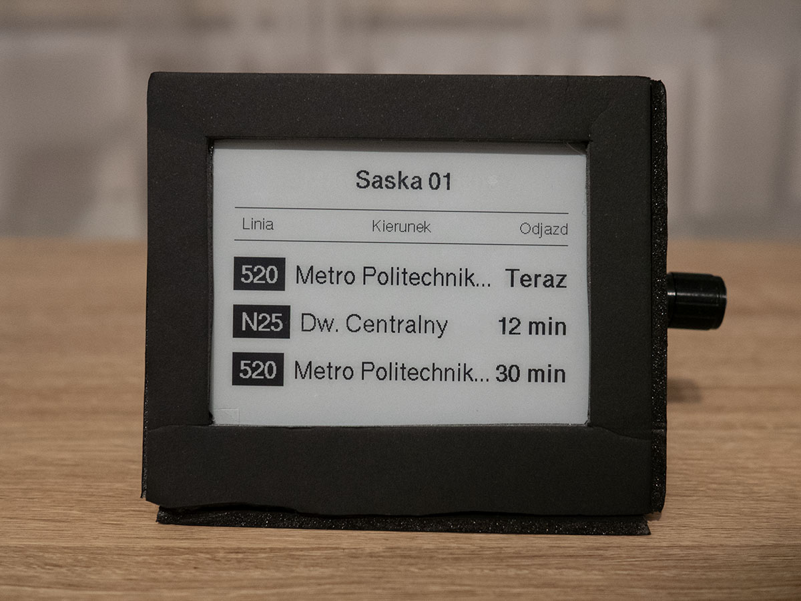
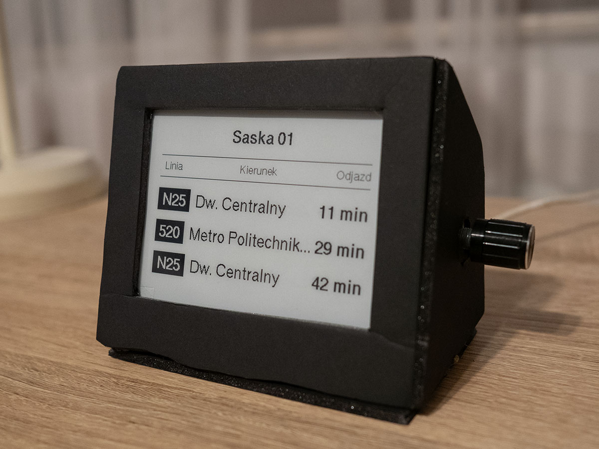

# E-Paper Bus Schedule

[](https://github.com/Ketnak22/epaper-bus-schedule/actions/workflows/ci.yml)

<table>
  <tr>
    <td></td>
    <td></td>
  </tr>
  <tr>
    <td align="center">Next departures from Saska 01</td>
    <td align="center">The encoder on the side</td>
  </tr>
</table>

A 4.2" e-paper display that shows the next three departures from a Warsaw
public transport stop. You switch between stops and platforms with a rotary
encoder.

It works. The enclosure in the photos is a temporary one, made of foam board
held together with hot glue.

The departures come from the planned ZTM timetable, so delays don't show up.
The ESP8266 doesn't talk to the ZTM API itself. A small FastAPI service in
[middleware/](middleware/) downloads the timetable, keeps it in a cache for an
hour and sends the device only the next 15 departures. The device turns WiFi
on just for that request and counts the minutes down on its own in between.

## Why a middleware

The first version ran on an ESP32-C3 Super Mini and called the API directly.
On a busy stop it ran out of RAM, because the full timetable for one stop can
be over 50 KB. The Wemos D1 mini I use now has even less memory. So the server does
the parsing and sorting, and the board gets a short list it can use as is.


## Hardware

### Parts

- Wemos D1 mini (ESP8266)
- GDEY042T81 4.2" black and white e-paper display (SPI)
- Rotary encoder with a push button
- Jumper wires
- USB cable and a 5 V USB power supply
- Foam board and hot glue for the enclosure

### Wiring

| Signal      | D1 mini | GPIO | Notes                              |
| ----------- | ------- | ---- | ---------------------------------- |
| EPD SCK     | D5      | 14   | hardware SPI                       |
| EPD MOSI    | D7      | 13   | hardware SPI                       |
| EPD CS      | D8      | 15   | must be low on boot                |
| EPD DC      | D6      | 12   |                                    |
| EPD RST     | D4      | 2    | must be high on boot               |
| EPD BUSY    | D0      | 16   |                                    |
| Encoder CLK | D1      | 5    | interrupt                          |
| Encoder DT  | D2      | 4    | interrupt                          |
| Encoder SW  | RX      | 3    | Serial is TX only, see below       |

If the board doesn't boot with the display connected, add a 3.3k pull-down
from D8 to GND.

The encoder button is on RX, so don't hold it while uploading. It also means
the serial monitor can only show output and can't send anything to the board.

## Setup

### Middleware

Get an API key from [api.um.warszawa.pl](https://api.um.warszawa.pl), then:

```sh
cd middleware
cp .env.example .env    # and put your key in it
pip install -r requirements.txt
uvicorn main:app --host 0.0.0.0 --port 8000
```

To run it on another machine, set `REMOTE_HOST` to its address and run
`deploy_image.sh`. The script copies the Docker image there and loads it, but
doesn't start a container. `.env` isn't part of the image, so keep it on that
machine and pass it in:

```sh
docker run --env-file .env -p 8000:8000 bus-stop-middleware:latest
```

The middleware has no authentication and the device talks to it over plain
HTTP. Keep it on your local network and don't expose it to the internet.

You can try the server without the device or an API key. With `MOCK=1` in
`.env` it returns sample departures:

```sh
curl "localhost:8000/get_stop_schedule?busStopId=7009&busStopNr=01&currentTimeInMinutes=600"
```

### Firmware

```sh
cp include/secrets.example.h include/secrets.h    # and fill it in
pio run --target upload
```

The stops are listed in `busStops` in `src/main.cpp`.

### Adding a stop

I get stop IDs from the
[WTP timetable page](https://www.wtp.waw.pl/rozklady-jazdy/?wtp_dt=2026-11-01&wtp_md=1).
Find the stop and copy the number shown above its name, for example
`Przystanek 2143` for Afrykańska. It's also the `wtp_st` value in the address
of the stop's page. The platform numbers are at the end of the names listed
below it (`Afrykańska 01`, `Afrykańska 02`).

The API calls these `busStopId` and `busStopNr` (the `dbtimetable_get`
resource on [api.um.warszawa.pl](https://api.um.warszawa.pl)). Add an entry
to `busStops` and raise the size of the `std::array` by one:

```cpp
{"2143", {"01", "02"}, "Afrykańska"},
```

## Controls

| Action        | Result                                               |
| ------------- | ---------------------------------------------------- |
| Turn          | Previous or next number of the current stop          |
| Press         | Open stop selection                                  |
| Hold over 6 s | Clear the display and power off, press RESET to wake |

In stop selection:

| Action        | Result                  |
| ------------- | ----------------------- |
| Turn          | Browse the stops        |
| Press         | Confirm                 |
| Hold 1-6 s    | Cancel                  |
| Wait 10 s     | Cancel                  |

Departures load about a second after you stop turning the encoder. The last
stop and number are saved in flash, so they come back after a restart.

## License
See [LICENSE](LICENSE).