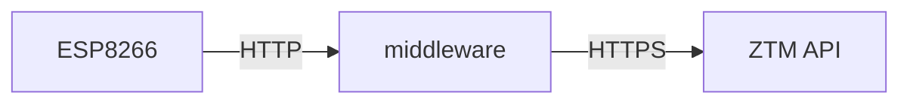

# E-Paper Bus Schedule

<!-- TODO: add photo -->


Shows the next three departures from a Warsaw public transport stop on a
4.2" e-paper display. A rotary encoder switches between stops and platforms.
The data comes from the planned ZTM timetable, so delays are not taken into
account, and the server keeps it in a cache for an hour.

Status: working prototype, enclosure planned.

The ESP8266 doesn't talk to the ZTM API directly. A small FastAPI service in
[middleware/](middleware/) downloads the timetable, sorts it and sends the
device only the next 15 departures. The device turns WiFi on only to fetch
data and updates the minutes left on its own in between.

### Why a middleware

The ESP8266 (Wemos D1 mini) and the ESP32-C3 Super Mini (which was used
before for this project) don't have enough RAM to process the timetable of a
busy stop. The closer to the city centre, the more departures a stop has, and
the full response is too big to parse on the device. So the heavy work is
moved to a server, and the microcontroller only gets a short, ready list.



## Hardware

- Wemos D1 mini (ESP8266)
- GDEY042T81 4.2" e-paper display
- Rotary encoder with a push button

| Signal      | D1 mini | GPIO | Notes                              |
| ----------- | ------- | ---- | ---------------------------------- |
| EPD SCK     | D5      | 14   | hardware SPI                       |
| EPD MOSI    | D7      | 13   | hardware SPI                       |
| EPD CS      | D8      | 15   | must be low on boot                |
| EPD DC      | D6      | 12   |                                    |
| EPD RST     | D4      | 2    | must be high on boot               |
| EPD BUSY    | D0      | 16   |                                    |
| Encoder CLK | D1      | 5    | interrupt                          |
| Encoder DT  | D2      | 4    | interrupt                          |
| Encoder SW  | RX      | 3    | Serial is TX only, see below       |

If the board doesn't boot with the display connected, add a 3.3k pull-down
from D8 to GND.

The button sits on RX, so don't hold it while uploading, and the serial
monitor only shows output, it can't send anything.

## Setup

### Middleware

Get an API key from [api.um.warszawa.pl](https://api.um.warszawa.pl), then:

```sh
cd middleware
cp .env.example .env    # and put your key in it
pip install -r requirements.txt
uvicorn main:app --host 0.0.0.0 --port 8000
```

To run it on another machine, set `REMOTE_HOST` to its address and run
`deploy_image.sh`. It copies the image and loads it into Docker there, but
doesn't start the container. `.env` is not part of the image, so keep it on that
machine and pass it in:

```sh
docker run --env-file .env -p 8000:8000 bus-stop-middleware:latest
```

With `MOCK=1` in `.env` the server returns sample departures and needs no API
key, so you can try it without the device:

```sh
curl "localhost:8000/get_stop_schedule?busStopId=7009&busStopNr=01&currentTimeInMinutes=600"
```

### Firmware

```sh
cp include/secrets.example.h include/secrets.h    # and fill it in
pio run --target upload
```

The stops are listed in `busStops` in `src/main.cpp`.

### Adding a stop

Find the stop in the `dbtimetable_get` resource on
[api.um.warszawa.pl](https://api.um.warszawa.pl). It gives the stop ID
(`busStopId`) and the platform numbers (`busStopNr`, like `01`). Add an entry to
`busStops` and raise the size of the `std::array` by one:

```cpp
{"1234", {"01", "02"}, "Stop name"},
```

## Controls

| Action        | Result                                               |
| ------------- | ---------------------------------------------------- |
| Turn          | Previous or next number of the current stop          |
| Press         | Open stop selection                                  |
| Hold over 6 s | Clear the display and power off, press RESET to wake |

In stop selection:

| Action        | Result                  |
| ------------- | ----------------------- |
| Turn          | Browse the stops        |
| Press         | Confirm                 |
| Hold 1-6 s    | Cancel                  |
| Wait 10 s     | Cancel                  |

Departures load about a second after the encoder stops turning. The last
stop and number are saved in flash and come back after a restart.

The middleware has no authentication and is meant for a local network, so
don't expose it to the internet.
